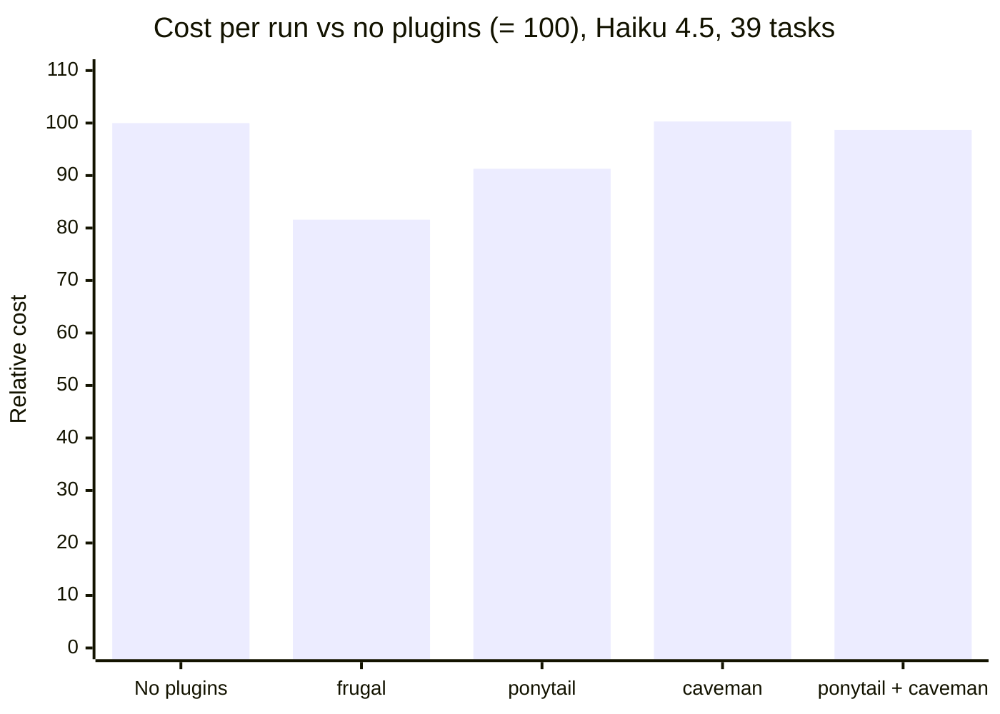

# frugal benchmarks

Full results behind the summary in the [README](README.md#benchmarks): how each test works, the current batches task by task, and every earlier batch, newest first. Arms are only compared within the same batch, because the system prompt changes between batches.

## Tests

Costs are the `total_cost_usd` Claude Code reports.

- `bench/bench.py`: fixed tasks in a temp copy of a fixture. t1 fix a bug without touching the test; t2 find the largest month-over-month drop in a CSV; t3 draft a support reply with placeholders for unknown facts; t4 a 16-message session; t5 log triage, a rate limiter from scratch, and a long explanation; t6 extract notice periods from 30 contracts into a CSV; t7 a 40-message session; t8 a risk review of the same 30 contracts; t9 a risk review of 150 contracts (~165k tokens), each with one planted risk that must be named, checked for at least 90% of vendors.
- `bench/ponytail_agentic`: ponytail's own agentic benchmark (MIT) with frugal and ponytail + caveman arms added: 39 security, reuse, root-cause, open-ended, vibe, frontend, and backend tasks, scored by its own checks. caveman and ponytail run at `full`, their default.
- Lines of code count source only. Tests count separately whether they sit in `test_*.py` or in a test function inside the same file (`def _test()` and the like); before 2026-10-10 the in-file kind counted as source on open tasks, which moved frugal's Opus median from 40.5 to 39 lines and nothing else.
- `bench/caveman_eval.py`: caveman's own ten dev questions, each answered with a replaced system prompt ("Answer concisely." alone, plus caveman's `SKILL.md`, or plus frugal's), scored blind by a Sonnet judge from 0 to 3.

**How batches stay affordable.** Most of a run's cost is Claude Code's own context, not the task, so a full matrix (39 tasks, five arms, three runs, three models) would cost hundreds of dollars. Instead:

1. Fixed cost is measured once per model with `t0_ok`, a one-word task. It is deterministic, so a few warm runs give the exact overhead each plugin adds; `bench.py report` prints it against no plugins.
2. Behavior (lines of code, turns, pass rate) is measured on Haiku over all 39 tasks.
3. Sonnet and Opus confirm it on `core8`, eight tasks covering every category. Their intervals are wider, and the README shows them.
4. `--runs 2 --max-runs 3` adds a run only where cost varies more than 25% or pass and fail are mixed.
5. Arms that did not change are reused from an earlier batch (`--reuse`) only if a baseline rerun on four anchor tasks matches it within 10%; otherwise every arm reruns together. Reused cells are labeled in `results.json`.

## Current batches

### frugal 0.29.0 against no plugins, Haiku 4.5 and Sonnet 5.5

ponytail's harness, all 39 tasks, n=2, 156 cells per model, both arms in one batch per model (2026-11-20, Claude Code 2.1.329; Haiku $8.68, Sonnet $11.12). Cost is the mean per run; "vs no plugins" is the geometric mean of the per-task cost ratio with a 90% bootstrap interval:

| Model | Arm | Correct | Safe | Lines (median) | Lines (mean) | USD per run | vs no plugins | Cheaper on |
|---|---|---|---|---|---|---|---|---|
| Haiku 4.5 | no plugins | 0.987 | 0.962 | 47 | 95.7 | 0.0587 | 0% | |
| | frugal | **1.000** | **0.974** | **25** | **46.0** | 0.0527 | -2.4% (-10.9% to +6.1%) | 16 of 39 tasks |
| Sonnet 5.5 | no plugins | 1.000 | 1.000 | 64 | 83.6 | 0.0734 | 0% | |
| | frugal | 1.000 | 1.000 | **31** | **41.6** | 0.0692 | -4.5% (-9.5% to +0.8%) | 23 of 39 |

Cost vs no plugins by task group:

| Model | Open-ended (15) | Template features (12) | Fixes, security, reuse (12) |
|---|---|---|---|
| Haiku 4.5 | -2.0% | -20.1% | +18.4% |
| Sonnet 5.5 | -15.3% | +0.2% | +5.8% |

On Haiku both arms missed `todo-null` safety once; plain Claude Code missed `trace-transfer` safety in 2 of 2 runs and frugal in 1 of 2, and plain Claude Code wrote no file in one `vibe-rename` run. Sonnet missed nothing.

Rerunning the two Haiku misses (2026-11-20, frugal arm only, n=5 to 10): `todo-null` passed 10 of 10, so its miss was noise. `trace-transfer` was real: 0.29.0 guarded the shared `_debit` in 4 of 10 runs and otherwise patched only `transfer`, without a grep, although the hook had pasted the code rules. Two rewordings of the bug-fix rule were measured: "the invariant must hold on every one of those paths" passed 7 of 10; "fix it at the line that writes the state, usually a shared helper, not in the function the report names" passed 9 of 10 at the same cost (0.049 to 0.052 USD per run), and is the one kept. On Sonnet, `trace-transfer`, `reuse-slug`, and `reuse-money` (n=3) passed every check with it, within 7% of the batch's cost.

**code.md trim** (2026-11-20, core8, n=2, frugal at a924a4f against trimmed variants). A first cut from 3,655 to 1,992 characters saved 4.7% on Sonnet with every check passing, but code grew on both models (Haiku `vibe-jsonconf` 44 to 84 lines, `vibe-rename` 61 to 94): it had dropped "no handling for impossible cases", "let file and argument errors raise" outside new scripts, and the exact check rule. With those back (2,219 characters) the length returned near the old one and the cost went -2.7% on Sonnet and -1.1% on Haiku. That cut also shortened the bug-fix rule, and Haiku `trace-transfer` fell to 1 of 7 safe; the kept version (2,391 characters, -35%) restores that rule word for word and passed 7 of 10, against 7 of 17 for a924a4f in the same hour on the same account (the morning's 9 of 10 ran on another account; this task is noisy on Haiku). A PreToolUse hook now also denies reading code.md once the prompt hook has pasted it: Haiku had re-read it in 15 of 48 runs of the 0.29.0 batch, Sonnet in none. On Haiku the kept version with that hook came out +3.3% at n=4, 31 of 32 runs safe against 30 of 32: two rounds of n=2 gave +19.5% (against the 0.29.0 install, which differs from a924a4f only in the bug-fix line) and -9.8% (against a924a4f), and the tasks that drove the first (`tmpl-be-search` +50%, `tmpl-fe-datepicker` +38%) reversed in the second (-40%, -26%), so the difference is within Haiku's run-to-run noise. Restoring six rules that runs had shown to matter ("never build the upgrade unasked", "not the code", wrappers and commands, the CLI `sys.argv` line, the trust-boundary detail, the one-line rung) brought code.md to 3,047 characters (-17%). Against a924a4f at core8, n=2, on another account: Sonnet +3.8% (0.0654 against 0.0630 USD per run), 24 lines in both, every check passed; Haiku -7.4% (0.0490 against 0.0529), 21 lines against 23, 16 of 16 safe against 15 of 16.

Against the 0.18.4 batch the gap narrowed (Haiku -6.6% to -2.4%, Sonnet -13.1% to -4.5%), mostly because plain Claude Code got cheaper: on Sonnet the baseline went from 0.0943 to 0.0734 USD per run (-22%) and from 73 to 64 median lines, while frugal went from 0.0806 to 0.0692 (-14%); on Haiku the baseline went from 0.0619 to 0.0587 and frugal from 0.0541 to 0.0527. The batches differ in runs per cell and Claude Code version, so this comparison is loose.

**Fixed cost.** `t0_ok` in `bench.py` first gave +3,722 input tokens on Sonnet and +1,928 on Haiku, against +1,243 and +802 for 0.18.5. Most of the Sonnet jump came from the bench: claude.ai connectors (Claude Docs here) connect at a random point of startup, and frugal's MCP server delays the first request, so the connector reached every frugal run and only some no-plugin runs. With it connected in both arms, Sonnet's fixed cost is +1,686 tokens (28,529 against 30,215, one run each): `SKILL.md` once `/frugal` loads it 1,052, the descriptions of four more skills and two agents about 400, the accounts hint about 130, and the deferred `delegate` tool 17. `bench.py` now turns claude.ai connectors off for every condition (`ENABLE_CLAUDEAI_MCP_SERVERS=false`); Haiku's fixed cost is still to be remeasured that way. The ponytail harness runs with `--strict-mcp-config`, so the batch above was not affected. That flag also drops frugal's `delegate`, and the hooks still pointed the frugal arm at it (the accounts hint, and a note past the read budget); no run spent a call looking for it.

### Head-to-head: frugal 0.18.4 against ponytail 5.2.0, three models

ponytail's own harness, all 39 tasks, n=3, 234 cells per model, both arms in one batch per model (Haiku 2026-10-15, Sonnet 2026-10-16, Opus 2026-10-16 to 20). ponytail ran from its v5.2.0 tag (`2961b52`) in its default `full` mode. Cost is the mean per run; "vs ponytail" is the geometric mean of the per-task cost ratio with a 90% bootstrap interval over tasks:

| Model | Arm | Correct | Safe | Lines (median) | USD per run | vs ponytail | Cheaper on |
|---|---|---|---|---|---|---|---|
| Haiku 4.5 | frugal | **1.000** | **1.000** | **27** | 0.0561 | **-8.3%** (-13.8% to -2.6%) | 26 of 39 tasks |
| | ponytail | 0.983 | 0.974 | 32 | 0.0605 | 0% | |
| Sonnet 5.5 | frugal | 1.000 | 1.000 | 29 | 0.0817 | **-5.8%** (-9.2% to -3.0%) | 29 of 39 |
| | ponytail | 1.000 | 1.000 | 28 | 0.0868 | 0% | |
| Opus 5.5 | frugal | **1.000** | 1.000 | 34 | 0.1631 | **-6.2%** (-10.4% to -2.1%) | 29 of 39 |
| | ponytail | 0.991 | 1.000 | 31 | 0.1747 | 0% | |

Mean code lines by task group (comments excluded):

| Model | Open-ended (15) frugal / ponytail | Template features (12) | Fixes and reuse (12) |
|---|---|---|---|
| Haiku 4.5 | **44.8** / 56.1 | **91.2** / 109.0 | 17.2 / 16.4 |
| Sonnet 5.5 | **51.0** / 52.2 | 52.8 / 47.8 | 18.5 / 17.6 |
| Opus 5.5 | 60.6 / 60.5 | 55.5 / 55.3 | 21.2 / 20.2 |

frugal failed no check on any model. ponytail missed `trace-transfer` safety in 3 of 3 Haiku runs (patched `transfer`, left `withdraw` overdrawing) and wrote no file in 2 Haiku runs of `vibe-rename` and 1 Opus run of `vibe-shortener`. On lines, ponytail leads on Sonnet's template tasks (up to 17 lines on `tmpl-fe-command`); reading `tmpl-fe-rating`, both arms built the same native-radio component and the gap was line wrapping and one optional prop. frugal's extra lines on fixes come from guarding the shared helper and fixing siblings, which is why it passes `trace-transfer`. On `vibe-restapi` frugal writes a stdlib `http.server` app where ponytail writes FastAPI, which needs an install.

Against ponytail 4.10.0, frugal was 13.2% cheaper on Haiku (0.17.0) and 3.4% cheaper on Sonnet (0.18.3), and on Opus the two were within each other's intervals (0.17.0). 5.2.0 narrowed the Haiku gap; 0.18.4's scope rule closed the open-ended line gap on Sonnet and Opus.

The Opus batch stopped at the usage limit after 166 cells and was finished with `--resume` four days later; the 12 template tasks ran entirely in the second session, both arms together. Its first scoring failed 3 runs of `reuse-money` and `reuse-slug` on import errors with files identical to passing runs: the scorers import produced modules by name through `sys.path` and `sys.modules`, and four cells scored in parallel raced. The harness now scores one cell at a time, and all three batches were rescored (`--rescore`, no API); only those Opus results changed.

### frugal 0.18.4 against no plugins, three models

ponytail's harness, all 39 tasks, n=3, 234 cells per model, both arms in one batch per model (Haiku 2026-10-20, $13.57; Sonnet 2026-10-20, $20.46, resumed with `--resume` the same day after the runner died at the usage limit; Opus 2026-10-20 to 21, $51.38). Cost is the mean per run; "vs no plugins" is the geometric mean of the per-task cost ratio with a 90% bootstrap interval:

| Model | Arm | Correct | Safe | Lines (median) | Lines (mean) | USD per run | vs no plugins | Cheaper on |
|---|---|---|---|---|---|---|---|---|
| Haiku 4.5 | no plugins | 0.940 | 0.974 | 48 | 110.6 | 0.0619 | 0% | |
| | frugal | **1.000** | **1.000** | **24** | **50.8** | 0.0541 | -6.6% (-14.0% to +1.2%) | 18 of 39 tasks |
| Sonnet 5.5 | no plugins | 1.000 | 1.000 | 73 | 98.4 | 0.0943 | 0% | |
| | frugal | 1.000 | 1.000 | **30** | **41.4** | 0.0806 | **-13.1%** (-19.0% to -7.2%) | 27 of 39 |
| Opus 5.5 | no plugins | 0.974 | 1.000 | 91 | 150.9 | 0.2852 | 0% | |
| | frugal | **1.000** | 1.000 | **34** | **47.2** | 0.1613 | **-38.2%** (-45.6% to -29.9%) | 34 of 38 |

Cost vs no plugins by task group:

| Model | Open-ended (15) | Template features (12) | Fixes, security, reuse (12) |
|---|---|---|---|
| Haiku 4.5 | -9.1% | -24.1% | +18.9% |
| Sonnet 5.5 | -25.9% | -8.9% | +1.0% |
| Opus 5.5 | -55.2% (14 tasks) | -38.1% | -10.3% |

Plain Claude Code missed `trace-transfer` safety in 3 of 3 Haiku runs (patched `transfer`, left `withdraw` overdrawing) and wrote no `.py` file in 7 Haiku runs (`vibe-rename` 3, `vibe-scraper` 2, `vibe-langgraph`, `vibe-logparse`). On Opus it was killed at the 300 s cell timeout on all 3 runs of `vibe-md2html`; that task has no cost for the baseline, so the Opus cost ratio covers 38 tasks (frugal paid 0.301 USD per run there).

The fixed cost is what loses on Haiku's small tasks. Each frugal session writes about 1,900 more tokens to the prompt cache (`SKILL.md`, the hook-injected `code.md`, plugin descriptions), and bug fixes add one or two calls to grep callers and siblings, which is also why frugal passes `trace-transfer`. On a 0.03 USD task that is +19%; on Sonnet it is +1% and on Opus -10%. In 2 of 117 Haiku runs frugal also handed a small task to `frugal-worker`, whose frontmatter pinned Sonnet; `critic-email` cost 0.074 USD in that run against 0.031 for no plugins. 0.18.5 sets the worker to the session model (`model: inherit`); the delegate module still passes a cheaper model explicitly. Against the five-arm batches of 0.17.0 (below), Haiku went from -18.4% to -6.6% and Sonnet and Opus held (-12.2% to -13.1%, -39.0% to -38.2%); the plain-Claude-Code Haiku baseline also got cheaper between batches (0.081 to 0.062 USD per run).

### Feature work: ponytail's harness, Haiku 4.5

Five-arm batch (2026-10-04), 39 tasks, n=3, 585 cells. Relative cost is the geometric mean of the per-task cost ratio against no plugins:

| Arm | Correct | Safe | Lines (median) | USD per run | vs no plugins |
|---|---|---|---|---|---|
| No plugins | 0.949 | 0.974 | 59 | 0.0810 | 0% |
| frugal | 0.974 | 0.983 | 38 | 0.0646 | -18.4% |
| ponytail | 0.991 | 0.966 | 38 | 0.0722 | -8.7% |
| caveman | 0.949 | 0.957 | 40 | 0.0830 | +0.3% |
| ponytail + caveman | 0.966 | 0.974 | 40 | 0.0793 | -1.3% |

That batch ran before the last 0.17.0 rule (Python by default, see below). frugal 0.17.0 against ponytail, all 39 tasks (2026-10-06), n=3, 234 cells, one batch. Cost is the mean per run; "vs ponytail" is the geometric mean of the per-task cost ratio:

| Arm | Correct | Safe | Lines (median) | USD per run | vs ponytail |
|---|---|---|---|---|---|
| frugal | 1.000 | 0.991 | 29 | 0.0512 | -13.2% (90% CI -19.6% to -6.8%) |
| ponytail | 0.983 | 0.974 | 31 | 0.0614 | 0% |

frugal passed every correctness check. Its one miss was a safety check on trace-transfer (1 of 3 runs patched `transfer` but not the shared debit that `withdraw` also uses); ponytail missed it in 3 of 3.

What changed in 0.17.0, each tested against the previous rules in its own batch on Haiku:

- With no shell, frugal sometimes spawned a subagent only to run a test, and sometimes left requested code in the scratchpad or only in the reply. `SKILL.md` now says requested code goes in a file in the working directory and that a check is never run by a subagent, and the worker's description excludes it. Both rules together, on the 12 tasks where frugal had failed (n=3): correct 0.806 to 0.944, runs with a subagent 7 of 36 to 1 of 36, cost -14.7%.
- A new script with no language named and no project files is Python with the stdlib. frugal had written JavaScript with npm packages for "build me a web scraper", which the harness scores as no file: 4 of 4 correct instead of 2 of 4, at 0.034 instead of 0.078 USD per run; the frontend control task was unchanged.

### Feature work: ponytail's harness, Sonnet 5.5

Five-arm batch (2026-10-07, frugal 0.17.0), 39 tasks, n=3, 585 cells, no cell failed to run. The first 234 cells (frugal and ponytail) and the other 351 were run in two passes of the same run directory, minutes apart. Relative cost is the geometric mean of the per-task cost ratio against no plugins:

| Arm | Correct | Safe | Lines (median) | USD per run | vs no plugins |
|---|---|---|---|---|---|
| No plugins | 1.000 | 1.000 | 71 | 0.0953 | 0% |
| frugal | 1.000 | 1.000 | 38 | 0.0823 | -12.2% (90% CI -16.8% to -7.6%) |
| ponytail | 1.000 | 1.000 | 27 | 0.0853 | -8.7% (-13.5% to -3.6%) |
| caveman | 1.000 | 1.000 | 77 | 0.1131 | +20.3% (+16.3% to +24.0%) |
| ponytail + caveman | 1.000 | 1.000 | 33 | 0.1017 | +10.3% (+4.1% to +16.8%) |

Lines are the median of code lines (comments excluded), as in the other tables. Every arm passed every check, so on Sonnet the comparison is cost and size only. caveman costs more than no plugins here and leaves the code about the same size.

frugal 0.18.3 against ponytail, all 39 tasks (2026-10-15), n=3, 234 cells, one batch, $20.04. Cost is the mean per run; "vs ponytail" is the geometric mean of the per-task cost ratio with a 90% bootstrap interval over tasks:

| Arm | Correct | Safe | Lines (median) | Lines (mean) | USD per run | vs ponytail |
|---|---|---|---|---|---|---|
| frugal 0.18.3 | 1.000 | 1.000 | 34 | 43.5 | 0.0845 | -3.4% (-5.6% to -1.1%) |
| ponytail | 1.000 | 1.000 | 31 | 39.8 | 0.0868 | 0% |

frugal was cheaper on 28 of 39 tasks. ponytail still writes less: 49.1 against 54.0 mean lines on the 15 open-ended tasks and 33.9 against 36.9 on the other 24. The largest gaps went both ways (`vibe-adventure` +39, `tmpl-fe-command` +30, `vibe-md2html` -21, `tmpl-fe-colorpicker` -20). On the open-ended tasks the gap was 21 lines with 0.17.0 (70.7 against 49.3, table below) and 5 here.

### Feature work: ponytail's harness, Opus 5.5

Five-arm batch (2026-10-07 to 08, frugal 0.17.0), n=3. 34 of 39 tasks finished in every arm (510 cells); the rest stopped at the usage limit and are not counted. Lines are the median of code lines (comments excluded), as in the other tables. Relative cost is the geometric mean of the per-task cost ratio against no plugins, with a 90% bootstrap interval over tasks:

| Arm | Correct | Safe | Lines (median) | USD per run | vs no plugins |
|---|---|---|---|---|---|
| No plugins | 0.980 | 0.980 | 151 | 0.2842 | 0% |
| frugal | 0.990 | 0.990 | 39 | 0.1515 | -39.0% (-46.8% to -30.2%) |
| ponytail | 0.990 | 1.000 | 34 | 0.1596 | -36.0% (-44.5% to -26.1%) |
| caveman | 0.990 | 0.990 | 124 | 0.2959 | +8.1% (+2.0% to +14.4%) |
| ponytail + caveman | 0.941 | 0.980 | 41 | 0.1870 | -23.9% (-34.1% to -12.1%) |

Opus without plugins over-builds most (151 lines), so both minimal-code rule sets save the most here. frugal and ponytail are within each other's intervals; ponytail + caveman fails more correctness checks than either alone.

### frugal 0.18.0: open-ended tasks, three models

The 15 `vibe-*` and `open-*` tasks, n=3 (2026-10-13). Reading the Opus code of 0.17.0 against ponytail showed the extra lines were scope, not form: unrequested options and syntax, upgrades ponytail leaves as a `ponytail:` comment (temp-name staging, sequence heuristics), argparse where `sys.argv` does, and try/except that only rewords a traceback. Docstrings, logging, and classes differed by about 0 lines. 0.18.0 adds two lines to `code.md` for that. Mean code lines (comments excluded):

| Model | frugal 0.17.0 | frugal 0.18.0 | ponytail | Change | Correct (0.18.0) | Safe (0.18.0) |
|---|---|---|---|---|---|---|
| Sonnet 5.5 | 70.7 | 58.5 | 49.3 | -17% | 1.000 | 1.000 |
| Opus 5.5 | 78.6 | 65.0 | 58.4 | -17% | 0.978 | 1.000 |
| Haiku 4.5 | 51.9 | 48.1 | 56.2 | -7% | 1.000 | 1.000 |

Haiku ran all three arms in one batch. Sonnet and Opus ran only 0.18.0 and reuse 0.17.0 and ponytail from the 2026-10-07 batches; the anchor check failed on cost (+116%, a cold prompt cache) while anchor lines stayed in range, so only lines, correctness, and safety are compared there. The one Opus failure printed the code instead of writing the file; ponytail failed one Opus task too. Runs that left a separate test: Sonnet 11 to 7 of 45, Opus 23 to 21; on Sonnet, 0.18.0 left asserts under `__main__` in 30 more runs, so 37 of 45 had a check.

On the other 24 tasks (Haiku, n=3, same batch) 0.18.0 kept correctness at 1.000 but safety fell from 0.986 to 0.958: one `todo-null` run guarded `JSON.parse` but not `data.title` on a `null` body, likely from the rule against try/except that only rewords a traceback, and `trace-transfer` failed 2 of 3 against 1 of 3. 0.18.1 scopes the ceiling rule to new code and the error rule to CLI scripts. Haiku, n=9, same batch:

| Task | 0.17.0 | 0.18.1 |
|---|---|---|
| todo-null | 8/9 | 9/9 |
| trace-amount | 9/9 | 9/9 |
| trace-transfer | 4/9 | 3/9 |

`trace-transfer` is noisy on Haiku for both versions (0.17.0 passed 2 of 3 and 5 of 6 in the two earlier batches); the one-run difference is within that noise. On `vibe-csvstats` (n=6) the candidate wrote 35 lines against 41.5 for 0.17.0.

`trace-transfer` failures read `bank.py`, guard `transfer`, and stop; one reply even noted that `withdraw()` has the same issue and left it. The rules reach Haiku (the hook injects `code.md`), so 0.18.2 makes the bug-fix line concrete: the guard goes in the shared helper, not the function the report names, and a sibling with the same bug is in scope. Haiku, two batches, 0.17.0 and 0.18.2 in each:

| Task | 0.17.0 | 0.18.2 |
|---|---|---|
| trace-transfer (n=9, twice) | 5/9, 4/9 | 8/9, 6/9 |
| trace-amount (n=9) | 9/9 | 9/9 |
| auth-token, reuse-money, safe-path, sql-user (n=3 each) | 12/12 | 12/12 |
| reuse-slug (n=3) | 3/3 | 2/3 |
| todo-null (n=3) | 3/3 | 2/3 |

The `reuse-slug` failure printed the code instead of writing the file, the same failure seen once on Opus 0.18.0 and once each on ponytail; the `todo-null` failure is the narrow try around `JSON.parse`, which 0.17.0 also showed in 1 of 9 runs above.

Both frugal misses trace to the output line in `code.md`, `code first, copy-paste safe`. Haiku read the files, replied with the function in a code block and "Implement in `articles.py:2-5`", and left the stub. Opus answered `vibe-shortener` in one turn with no tool call and said it had written `shortener.py`, which does not exist. 0.18.3 says code goes into files through the edit tools, a file is reported written only after the call that wrote it, and code goes in the reply only with no edit tool or when a snippet is asked for. Haiku, `reuse-slug`, n=6, 0.18.3 alone (not the same batch as 0.18.2, so only file writes and correctness are compared): 6 of 6 wrote `articles.py` and passed, against 2 of 3 for 0.18.2, and no reply carried a code block. Six runs settle the Haiku case, not the 1-in-45 rate on Opus.

The new line reaches every code task, so 0.18.3 also ran against 0.18.2 on all 39 tasks in one batch (Haiku, `--runs 2 --max-runs 3`, 167 cells, $9.16):

| Version | Cells | Correct | Safe | LOC (median) | $/run |
|---|---|---|---|---|---|
| 0.18.2 | 83 | 1.000 | 0.988 | 26 | 0.0551 |
| 0.18.3 | 84 | 1.000 | 0.988 | 25.5 | 0.0545 |

Each version missed safety once, on the same `trace-transfer` case (only `transfer` patched). `open-dataclass` and `open-decorators` ask for an example, not a file; 0.18.3 answered in the reply in 4 of 4 runs and 0.18.2 in 3 of 4, so the rule did not force files where a snippet fits. Per-task lines moved by up to 30 in both directions at n=2 (`vibe-jsonconf` +28.5, `vibe-restapi` -15.5); the median held.

### frugal 0.18.4: unrequested features and limits

Reading the Sonnet code of 0.18.3 against ponytail (2026-10-15 batch above) showed the extra lines were scope again, not tests (9.3 against 9.8 test lines, `__main__` blocks 1.6 lines apart): extra commands, rooms, and aliases in `vibe-adventure`, sequence detection in `vibe-password`, body-size and title-length limits in `todo-null` from "never cut validation at trust boundaries". 0.18.4 adds features, commands, options, and limits to the unrequested list (an extra worth having goes in the `frugal:` comment) and says trust-boundary validation rejects malformed, missing, or unsafe input, with size or rate limits only when asked. The 15 open-ended tasks, the 9 safety tasks, and `tmpl-fe-command`, n=3, 150 cells per model, one batch each (2026-10-15). Cost is the geometric mean of the per-task cost ratio with a 90% bootstrap interval:

| Model | Version | Correct | Safe | Lines (mean) | Open-ended lines (mean) | USD per run | vs 0.18.3 |
|---|---|---|---|---|---|---|---|
| Sonnet 5.5 | 0.18.3 | 1.000 | 1.000 | 48.3 | 55.5 | 0.0763 | 0% |
| | candidate | 1.000 | 1.000 | 44.5 | 51.0 | 0.0737 | -2.8% (-5.4% to -0.3%) |
| Haiku 4.5 | 0.18.3 | 1.000 | 0.987 | 42.6 | 46.6 | 0.0430 | 0% |
| | candidate | 0.987 | 1.000 | 42.4 | 45.3 | 0.0407 | -4.4% (-8.5% to -0.2%) |

On Sonnet the largest drops were `vibe-md2html` -24, `vibe-todo` -18, `tmpl-fe-command` -16, `vibe-shortener` -16, and `todo-null` -12, with every safety task still passing; `vibe-adventure` did not move. Haiku already wrote less than ponytail, so its lines barely changed. Haiku's one safety miss was 0.18.3 on `trace-transfer`. The candidate's one miss wrote `config_loader.py` to the scratchpad on `vibe-jsonconf`, an older Haiku failure the rule does not touch; 0.18.4 also names the working directory and the scratchpad in the output line of `code.md`, as `SKILL.md` already did. That last wording was not in the measured candidate.

### Fixes, analysis, and heavy tasks: Haiku 4.5 and Sonnet 5.5

frugal 0.18.5 from this repo (`bench.py` condition V, `--plugin-dir`) against no plugins (A), the six tasks of the Opus table below plus `t0_ok`, n=3, one batch per model (2026-10-20 to 21). Median cost per run in USD, with runs that passed each task's checks:

| Task | Haiku: no plugins | frugal | Difference | Sonnet: no plugins | frugal | Difference |
|---|---|---|---|---|---|---|
| t0 fixed cost | 0.021 | 0.023 | +10% | 0.051 | 0.056 | +10% |
| t1 bug fix | 0.072 | 0.072 | 0% | 0.083 | 0.085 | +2% |
| t2 CSV question | 0.034 | 0.035 | +3% | 0.073 | 0.078 | +7% |
| t3 support reply | 0.035 | 0.036 | +3% | 0.080 | 0.085 | +6% |
| t5 heavy | 0.228 | 0.160 | **-30%** | 0.166 | 0.175 | +5% |
| t6 30 contracts | 0.153 (2 of 3) | 0.152 (2 of 3) | -1% | 0.147 (2 of 3) | 0.136 (3 of 3) | -7% |
| t8 risk review | 0.153 | 0.151 (2 runs) | -1% | 0.236 | 0.262 | +11% |
| **Sum, t1 to t8** | **0.675** | **0.606** | **-10.1%** | **0.785** | **0.821** | **+4.6%** |

On Haiku frugal pays for itself on the heavy task (-30%) and comes out even elsewhere. On Sonnet it loses 5% over the six tasks: the fixed cost (+1,243 input tokens, +0.005 USD a session in warm `t0_ok` runs, against +802 tokens on Haiku) is a large share of a 3-call task, and `t5` and `t8` did not win it back (one `t8` run cost 0.327 against a 0.262 median). frugal passed 21 of 21 on Sonnet against 20 of 21; both arms missed `t6` once on Haiku. One Haiku `t8` run of frugal was not saved.

### Fixes, analysis, and heavy tasks: Opus 5.5

frugal 0.15, six tasks of `bench.py` (2026-10-03), median cost per run in USD, n=3. Every run passed every check.

| Task | No plugins | frugal | Difference | Output tokens |
|---|---|---|---|---|
| t1 bug fix | 0.135 | 0.157 | +16% | 608 to 724 |
| t2 CSV question | 0.127 | 0.134 | +6% | 632 to 566 |
| t3 support reply | 0.137 | 0.147 | +7% | 1,145 to 1,125 |
| t5 heavy | 0.347 | 0.287 | -17% | 5,946 to 4,134 |
| t6 30 contracts | 0.232 | 0.221 | -5% | 1,994 to 1,855 |
| t8 risk review | 0.398 | 0.432 | +9% | 5,700 to 5,895 |
| **Sum** | **1.376** | **1.378** | **0%** | **16.0k to 14.3k (-11%)** |

t1 cost more because this batch made every code task read `code.md`. That rule now applies on Opus and Fable only past 3 tool calls; a t1 rerun of 3 runs each came out 0.136 to 0.145 (+7%), with fewer output tokens. t4, t7, and t9 were not rerun.

### Plain questions: caveman's eval, Haiku 4.5 and Sonnet 5.5

Same ten questions and Sonnet judge as the Opus table below, frugal 0.18.5's `SKILL.md`, n=20 answers per arm (2026-10-21). On Haiku 18 of 60 cells returned no output when the session limit hit at the end of the batch, leaving n=14 per arm:

| Model | Arm | Median output tokens | Mean output tokens | Mean characters | Mean cost per answer | Judge score |
|---|---|---|---|---|---|---|
| Haiku 4.5 | "Answer concisely." | 492 | 520 | 1,383 | 0.00315 | 2.21 |
| | caveman | 778 | 785 | 1,034 | 0.00619 | 2.00 |
| | frugal | **297** | **326** | **649** | **0.00285** | **2.29** |
| Sonnet 5.5 | "Answer concisely." | 460 | 496 | 1,329 | 0.00752 | 3.00 |
| | caveman | 374 | 370 | 930 | 0.00671 | 2.90 |
| | frugal | **272** | 341 | **927** | **0.00583** | 3.00 |

frugal answered shortest on both models at equal or higher judged quality: 22% cheaper than the control on Sonnet and 10% on Haiku. caveman cost twice the control on Haiku (its visible answers were shorter, its output tokens 50% higher) and scored lowest on both.

### Plain questions: caveman's eval, Opus 5.5

caveman's own ten dev questions (`evals/prompts/en.txt`), each answered with a replaced system prompt: "Answer concisely." alone, plus caveman's `SKILL.md`, or plus frugal's. n=20 answers per arm; a Sonnet judge scored each answer blind, 0 to 3.

| Arm | Median output tokens | Mean output tokens | Mean cost per answer | Judge score |
|---|---|---|---|---|
| "Answer concisely." | 560 | 605 | 0.0172 | 2.95 |
| caveman | 514 | 483 | 0.0159 | 3.00 |
| frugal 0.15 | 488 | 524 | 0.0158 | 2.95 |

A tie on caveman's ground: lower median, higher mean, same cost, same quality (one answer at 2 in each of the control and frugal arms). Script: `bench/caveman_eval.py`.

frugal's visible answers were already the shortest (922 to 1,024 characters against caveman's 1,184 to 1,230); its output tokens were not, because Opus counts its thinking as output and frugal's rules made it weigh more before answering (roughly 250 hidden tokens per answer against caveman's 155, estimated as output tokens minus characters / 3.6). Two variants in one batch, n=20 each: removing the rules that ask for a decision on every task cut output 20%; a first line that sends plain questions straight to an answer, with only the reply and exactness rules applying, cut it 33%. 0.16.0 ships that line. Rerun against caveman (2026-10-03, n=20 each):

| Arm | Median output tokens | Mean output tokens | Mean characters | Judge score |
|---|---|---|---|---|
| caveman | 504 | 493 | 1,196 | 3.00 |
| frugal 0.16.0 | 278 | 354 | 922 | 3.00 |

**Fixed cost.** A one-word task (`t0_ok`, "Reply with only the word ok", Opus, n=8) measures what having frugal on costs before it saves anything: the plugin enabled adds ~330 input tokens (skill and agent descriptions), `/frugal` adds ~1,140 in all. Claude Code writes them to the prompt cache once per session, about 0.009 USD on Opus. On a 3-call task that is the whole difference: 0.16.0 vs no plugins, n=4, t1 bug fix +1%, t2 CSV question +8%, t3 support reply +4%, all passed. Tasks that short have too little output to pay the fixed cost back; longer ones do.

### How this relates to the published numbers

- **caveman** reports 65% fewer output tokens on single API calls against a model with no system prompt, whose average reply was 1,214 tokens. Its README notes that the rules cost 1 to 1.5k input tokens per turn and that already-terse workloads can lose money.
- **ponytail** reports 54% fewer lines of code and 20% lower cost on 12 feature tasks in its harness, with Haiku 4.5 and n=4. Our 39-task batch with Haiku 4.5 found ponytail 8.7% cheaper than no plugins, with 36% fewer lines of code (median 38 against 59).

## History

### frugal 0.15: ponytail's harness, Haiku 4.5

First batch, nine tasks (security, reuse, root cause, open-ended, vibe, frontend, backend), n=2, every cell correct:

| Arm | Cost, sum of task means | Lines of code, sum | Over-engineering (judge, 0 to 3) |
|---|---|---|---|
| No plugins | 0.660 | 1,016 | 0.56 |
| frugal | 0.602 | 556 | 0.33 |
| ponytail | 0.615 | 384 | 0.28 |

frugal lost on the frontend: Haiku built a calendar instead of the native date input, and added demo files. 0.15 then named the native elements in `code.md` (`<input type="date">`, `type="color"`, `<dialog>`, `
`), made code tasks read the code rules, and put the root-cause rule in the core. Rerun of the four weakest tasks, same batch for both arms, n=2:

| Task | frugal USD | ponytail USD | frugal lines | ponytail lines |
|---|---|---|---|---|
| Date picker | 0.083 | 0.102 | 37 | 80 |
| Color picker | 0.061 | 0.130 | 22 | 226 |
| Mandelbrot | 0.037 | 0.065 | 33 | 61 |
| trace-transfer | 0.028 | 0.039 | 17 | 17 |
| **Over-engineering (judge)** | **0.00** | **1.25** | | |

ponytail's color picker ranged from 68 to 226 lines between the two batches: at n=2 single tasks swing a lot. The harness checks root-cause fixes on trace-transfer (the bug report names `transfer`, the shared `_debit` also breaks `withdraw`): after the core rule, frugal fixed the shared cause in 4 of 7 runs across three batches, ponytail in 1 of 6. The judge is the harness's own `judge.py` (Sonnet, validated by its selftest), run through `claude -p` when no API key is set; on template tasks it reads the agent's diff instead of the whole repo.

### frugal 0.14, Opus 5.5

One batch (2026-10-02), median cost per run in USD, n=4 (t7 and t9 n=2). Every run passed every check.

| Task | No plugins | frugal | Difference | Output tokens |
|---|---|---|---|---|
| t1 bug fix | 0.134 | 0.130 | -4% | 620 to 412 |
| t2 CSV question | 0.126 | 0.134 | +6% | 483 to 594 |
| t3 support reply | 0.139 | 0.143 | +3% | 1,222 to 1,002 |
| t4 16 messages | 0.626 | 0.613 | -2% | 8,807 to 7,554 |
| t5 heavy | 0.322 | 0.284 | -12% | 5,308 to 3,776 |
| t6 30 contracts | 0.225 | 0.259 | +15% | 1,920 to 1,972 |
| t7 40 messages | 1.498 | 1.316 | -12% | 19,788 to 15,884 |
| t8 risk review | 0.384 | 0.345 | -10% | 5,696 to 4,736 |
| t9 150 contracts | 0.325 | 0.336 | +4% | 5,223 to 4,712 |
| **Sum** | **3.779** | **3.560** | **-6%** | **49.1k to 40.6k (-17%)** |

Single tasks move a lot between batches at n=4: t6 ranged from -12% to +29% across six batches, and t8 from -18% to +13% across four. The sum is the number to trust.

### frugal 0.14: ponytail's harness, Haiku 4.5

`bench/ponytail_agentic` is ponytail's own agentic benchmark (MIT) with a frugal arm added: feature tasks in a FastAPI + React template, scored by its own checks. caveman and ponytail ran at `full`, their default. Same batch as the 0.14 Opus run above, mean cost per run, n=4:

| Task | No plugins | frugal | ponytail | caveman |
|---|---|---|---|---|
| Date picker, USD | 0.141 | 0.129 (-8%) | **0.116 (-18%)** | 0.197 (+40%) |
| Date picker, lines of code | 461 | 234 | **102** | 393 |
| Search endpoint, USD | 0.100 | 0.106 (+6%) | 0.104 (+4%) | 0.124 (+24%) |
| Search endpoint, lines of code | 46 | 45 | 41 | 46 |

Every cell passed. On the date picker the cost follows one design decision per run: in this batch frugal used the browser's native date input once in 21 lines, wrapped it in 320 lines once, and built a calendar component twice (211 and 256 lines). Across five batches while frugal's rules changed, frugal ranged from -8% to -57% on the date picker and ponytail from -18% to -58%; on the search endpoint every arm writes the same ~44 lines, so no rule set has anything to save and results swing from -20% to +35%.

One earlier 0.14 batch was stopped: a frugal run asked "standalone component or inside a form?" instead of building, and in a headless run nobody answers. 0.14 now builds the simplest option and names the alternative in one line.

### Earlier versions, Opus 5.5 and Sonnet 5.5

frugal 0.5, n=2, mean cost per run in USD. caveman and ponytail ran at `ultra`, their strongest level.

| Arm (Opus 5.5, batch 2) | t1 | t2 | t3 | t4 | t5 | Sum | vs no plugins | Output tokens per rep |
|---|---|---|---|---|---|---|---|---|
| Claude Code, no plugins | 0.133 | 0.129 | 0.144 | 0.669 | 0.323 | 1.398 | | 16.9k |
| caveman ultra + ponytail ultra | 0.187 | 0.182 | 0.196 | 0.733 | 0.384 | 1.681 | +20% | 15.4k |
| frugal 0.5 | 0.153 | 0.153 | 0.152 | 0.649 | 0.280 | 1.387 | -1% | 13.9k (-18%) |

| Arm (Sonnet 5.5, batch 3) | t1 | t2 | t3 | t4 | t5 | Sum | vs no plugins | Output tokens per rep |
|---|---|---|---|---|---|---|---|---|
| Claude Code, no plugins | 0.083 | 0.072 | 0.078 | 0.447 | 0.185 | 0.865 | | 13.0k |
| frugal 0.5 | 0.092 | 0.087 | 0.086 | 0.441 | 0.176 | 0.883 | +2% | 11.1k (-15%) |

caveman and ponytail separately (Opus 5.5, batch 1, frugal 0.6.0; t1 uses only the second run of each arm, because the first run of a batch pays for writing the system prompt cache):

| Arm | t1 | t2 | t3 | t4 | t5 | Sum | vs no plugins | First-call context |
|---|---|---|---|---|---|---|---|---|
| Claude Code, no plugins | 0.144 | 0.132 | 0.145 | 0.635 | 0.295 | 1.351 | | 38.7k |
| caveman ultra | 0.171 | 0.166 | 0.171 | 0.698 | 0.324 | 1.530 | +13% | 42.4k |
| ponytail ultra | 0.165 | 0.162 | 0.164 | 0.708 | 0.350 | 1.549 | +15% | 41.6k |
| caveman ultra + ponytail ultra | 0.181 | 0.184 | 0.203 | 0.729 | 0.360 | 1.657 | +23% | 45.3k |
| frugal 0.6.0 | 0.149 | 0.141 | 0.147 | 0.641 | 0.302 | 1.380 | +2% | 39.7k |

### What the earlier numbers say

- Input dominates: a one-message task reads 100k to 160k input tokens and writes 450 to 1,200. Opus and Sonnet in Claude Code already answer briefly, so cutting output alone saves little; loading fewer rules matters as much.
- caveman and ponytail add 3k to 7k tokens to every call in Claude Code. On fixes, analysis, and writing with Opus that cost 13 to 23% more than no plugins. On feature work with Haiku, where the model over-builds, ponytail pays for itself.
- Rules loaded on every call are the main cost on short tasks. 0.7 loaded ~1k tokens of rules on every task and cost 4 to 11% more than no plugins on one-message tasks (enabling the plugin alone adds ~0.3k). From 0.8 on, short tasks load only the small core: +0 to 3%.
- Delegation, forced with `/frugal delegate` on t5, t6, and t8: in 0.6, three haiku scouts cost 1.6 to 2.3 times plain Claude Code at the same quality. The haiku agents were cheap (0.14 to 0.22 USD); the main thread re-read the material to verify and woke up for each background agent. From 0.7 on, frugal delegated in 2 of 8 runs instead of 4, at 0.45 to 0.55 USD instead of 0.51 to 0.84.
- t9 was built to show delegation paying off at ~165k tokens. It did not get there: every arm, including the one forced to load `delegate`, found the planted clauses with a script instead of reading all 150 contracts, and none delegated. Opus scripts its way through regular documents; delegation pays off only on material a script cannot shortcut, which synthetic fixtures do not provide. The delegation rules are therefore checked for not wasting tokens, not yet for saving them.
- The 10th-message trigger was unreliable while it lived in the skill: the model loaded the session rules in 1 of 6 forty-message runs. With the hook it loaded them in all 6 long-session runs of the final batch (t4 and t7).

### Experiment: a `tight` profile (discarded)

0.7 shipped an opt-in `tight` profile to test whether cutting output harder than the default would lower total cost. It replaced the reply rules with `Done.` confirmations, bare answers, no headings or tables, short reasoning, and the fewest calls, while keeping exact values, warnings, deliverables, and tests.

It did not work. On Opus 5.5 in batch 2 it cost 1.425 USD (+2% vs no plugins) against 1.387 for the default profile, and wrote about the same output (13.7k vs 13.9k tokens per rep). The model loaded the profile in only 4 of 10 runs even after the rule was made mandatory, and one t4 run made 29 tool calls instead of 17. What output is left is deliverables (code, emails, explanations), which frugal never shortens, and reasoning, which a skill cannot limit (`/effort low` does that). 0.5 removed `tight`.
