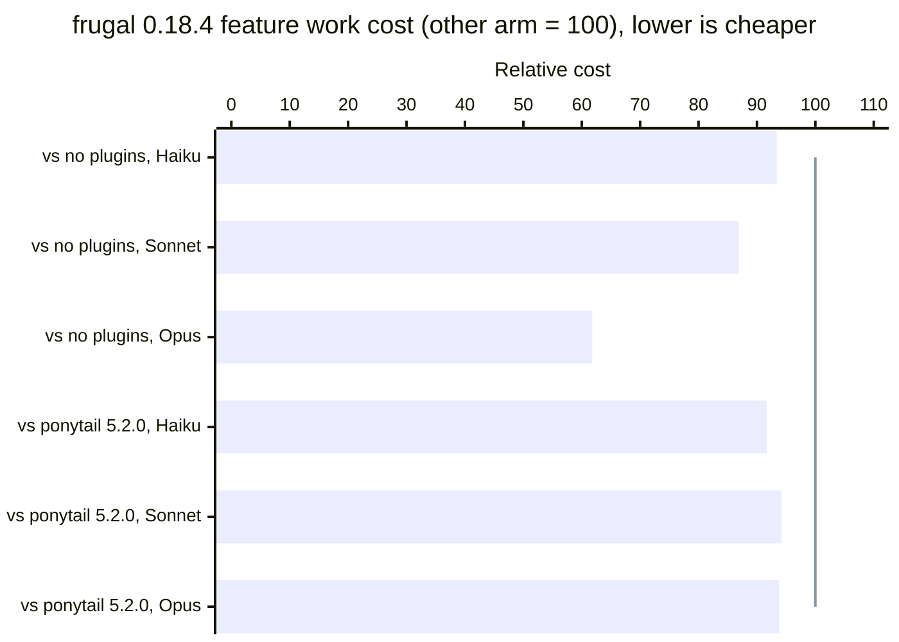
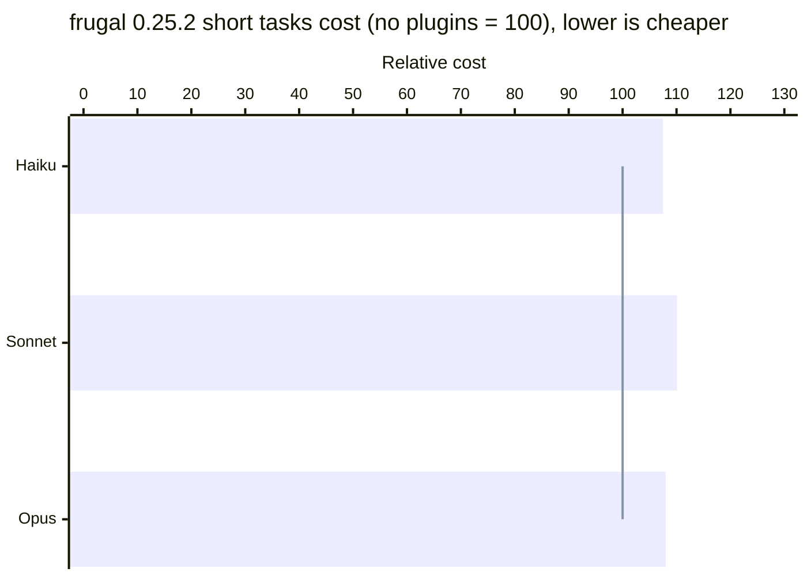

<picture>
  <source media="(prefers-color-scheme: dark)" srcset="docs/brand/frugal-mark-amber.svg">
  
</picture>

# frugal

[](#versions)
[](LICENSE)
[](#install)

A low-token working mode for Claude Code. Type `/frugal` and it stays on for the rest of the session.

Most of an agent session's bill is input, not output: every call re-reads the system prompt, the history, and every file and tool result in context. Shorter replies help a little; keeping the context small and making fewer calls helps much more.

## Install

### Let your agent install it

Paste this into Claude Code (CLI, desktop, or IDE), Claude Cowork, Codex, Cursor, or any agent that can run shell commands:

```text
Install the frugal plugin from https://github.com/frugal-hq/frugal for me.

1. If you are Claude Code: run `claude plugin marketplace add frugal-hq/frugal`, then `claude plugin install frugal@frugal`. Tell me to start a new session and type /frugal.
2. Otherwise, if you support Agent Skills (folders containing a SKILL.md): clone the repo to a temporary folder and copy every folder under skills/ into your user skills directory. Tell me how to invoke the frugal skill.
3. Otherwise: add the text of skills/frugal/SKILL.md without its front matter, then skills/frugal/core.md and skills/frugal/code.md, to your persistent instructions file (for example AGENTS.md) and tell me which file you changed.

Change nothing else. If the caveman or ponytail plugins are enabled, tell me, but do not disable them yourself.
```

Outside Claude Code, the subagents (`frugal-scout`, `frugal-worker`) and the model routing in `modules/delegate.md` do not apply, and step 3 installs only the core rules.

### By hand, in Claude Code

```
/plugin marketplace add frugal-hq/frugal
/plugin install frugal@frugal
```

Open a new session and type `/frugal`. If you also have a separate copy of `humanizer` or of the frugal skills in `~/.claude/skills`, remove it so they do not show up twice.

## Usage

```
/frugal                   # modules picked per task
/frugal analysis          # force a module
/frugal coding agents     # several modules
```

Say `normal mode` to turn it off.

Name modules after `/frugal` to force them, for example `/frugal analysis coding`.

## What it does

`/frugal` loads a 2.6KB core. A short task (3 tool calls or fewer) needs nothing else. Longer tasks read more rules by path, only the ones they need:

| Part | Loaded | What it does |
|---|---|---|
| `SKILL.md` | on `/frugal` | Terse replies, exact terms and numbers, APIs and versions verified instead of guessed |
| `core.md` | tasks over 3 tool calls, the 10th message, or a module named after `/frugal` | Batched tool calls, no re-reads, questions only when the answer changes the result |
| `code.md` | with `core.md`, on code tasks | Minimal code: reuse first, stdlib before dependencies, root-cause fixes, one runnable check. Never cuts validation, security, accessibility, or error handling that prevents data loss |
| `modules/analysis.md` | data, research, metrics, reports | Finding first; every number with a source and units; inferences labeled |
| `modules/delegate.md` | a bounded task of three or more tool calls, with or without secondary accounts, or independent heavy parts | Sends bounded work to secondary accounts, or to `haiku` and `sonnet` subagents |
| `modules/session.md` | the 10th message, then every 15th; a compaction; a new task; a model that does not fit | Model and effort advice, and a handoff block for a fresh chat |
| `modules/review.md` | reviews, audits, shortcut lists | One line per finding; audits ranked by lines saved |
| `modules/compress.md` | on request | Rewrites a memory file to fewer bytes, with a backup, keeping every instruction |
| `modules/agents.md` | pipelines, subagent prompts, machine-read output | Parseable output, no narration, no invented paths or fields |
| `scripts/usage.sh` | before a CLI handoff, or when you ask about usage | Context size and token totals from the session transcript |
| `hooks/session-count.sh` | every prompt, silent until needed | Injects `core.md` and `session.md` on schedule, and the handoff rule every 150k tokens. Needs `sh` (Git Bash on Windows) |
| `accounts/server.py`, `skills/accounts` | only while `~/.frugal/accounts.json` lists an account | Secondary Claude, Codex, Grok, and OpenCode accounts that take delegated work. Needs `python` on the PATH |
| `humanizer` | only if you say yes | Rewrites AI-sounding text. Based on [blader/humanizer](https://github.com/blader/humanizer), MIT |

**Cheaper models without settings.** The plugin ships two subagents, `frugal-scout` (read-only search and extraction) and `frugal-worker` (bounded edits). The `delegate` module passes the model on every call, so nothing in your settings changes:

| Session model | Search, read, extract | Bounded edits |
|---|---|---|
| Fable, Opus, Sonnet | haiku | sonnet |
| Haiku | haiku | haiku |

It delegates only when the raw material is too big to read directly, or more than ~30k tokens in a session that continues for many turns, because each subagent starts with an empty cache. The main thread then spot-checks at most two results, or all of them when an error would touch money, security, legal terms, or unrecoverable data. A part that fails is re-run one model up, and only that part.

**Secondary accounts.** Other Claude logins, Codex, Grok, and OpenCode can take the bounded work, so the main account's limits last. Set them up with `/frugal:accounts`:

| Command | Login | Needs |
|---|---|---|
| `add claude <id>` | Its own config in `~/.claude-<id>`, so it never touches the main login | |
| `add codex <id>` | The Codex login on this machine | |
| `add grok <id>` | The Grok Build login on this machine | `npm install -g @xai-official/grok` |
| `add opencode <id> <provider/model>` | One model per account, data in `~/.frugal/opencode-<id>`; free models need no login | `npm install -g opencode-ai` |

Add and login verify the signed-in email before an account joins the pool. From then on, in every session:

- The `delegate` tool runs each brief on the least-used account, in parallel for independent pieces, and moves to the next account when one hits its limit.
- Each provider gets its own model and effort per level: Claude `haiku`/`sonnet`/`opus` with low to max effort, Codex `gpt-6-luna`/`gpt-6.1-sol`/`gpt-6-astra` (only models the login lists) with low to xhigh, Grok `grok-4.6` with low to xhigh, OpenCode the account's one model. Work defaults to the standard level (`sonnet`, medium).
- A hook adds the delegation rule to the first prompt, and to a later one only when the prompt before it ran more than 5 reads or searches here and delegated nothing. Another sends test and build runs and subagents to `delegate` once (asking again runs them here); a sixth read or search in one prompt (shell commands that only read, such as `cat`, `grep` or `git log`, count too) still runs, with a note to hand the rest to `delegate`.
- Each delegated run gets 10 minutes, 20 at the heavy level and 30 at max.
- A logged-out account leaves the pool, and each prompt names the command to sign it in again (`/frugal:accounts login <id>`).
- Delegated Claude runs load frugal (`/frugal`), and Codex runs get its core rules in the brief.
- A delegated run never delegates again, and with no account set up none of this loads.
- OpenCode models that may train on what they receive (Big Pickle, MiMo, Flint, Iceman, Inkling, Nemotron) are blocked unless `opencode-training` is on.
- A brief that names MCP servers in `mcp` runs only on a Claude account, which gets just those servers from the session's own config (user scope and the project's). Other agents never get the session's MCP servers; which agents may use a server is each project's rule. Servers listed under `claude_only_mcp` in `~/.frugal/accounts.json` are also turned off in Codex's own config.
- Heads-up, in Claude Desktop only: after a turn with 6 or more tool calls, a side agent on a secondary account (no tools, light level) reads the end of the transcript and names one thing you might miss, shown as one `Heads up:` line. At most 8 checks and 4 notes per session. `/frugal:heads-up off` turns it off for the session, `off all` everywhere, `on` / `on all` back on. The transcript excerpt goes to that account, and never to Grok or OpenCode.

**Humanizer is opt-in.** The first time frugal is about to write text for people, it asks once: Yes, No, Always this session, or Never this session. It never runs for code, commits, or internal notes.

frugal covers what caveman and ponytail do, so you do not need them. If they are enabled, disable them: their rules are added to every call (see [Benchmarks](#benchmarks)).

## Should you use it?

- **Feature work:** on ponytail's harness (39 tasks, n=3), 0.18.4 cost 38% less than plain Claude Code on Opus 5.5 and 13% less on Sonnet 5.5, and on Haiku 4.5 it passed every check where plain Claude Code missed 10 of 117 runs, at a cost within noise (-7%). Against ponytail 5.2.0 it passed every check on all three models and cost 8.3% less on Haiku 4.5, 5.8% less on Sonnet 5.5, and 6.2% less on Opus 5.5.
- **Long sessions and heavy tasks:** in 0.14, 10 to 12% cheaper on the 40-message session, the heavy coding task, and the contract risk review, because shorter replies and fewer re-reads compound as a session grows. On Opus 5.5 (0.15, six tasks) it came out even on cost with 11% less output.
- **Short one-off tasks:** it costs more. In 0.25.2, four short tasks cost 7 to 10% more than no plugins on all three models: they have too little output to win back the cost of loading frugal.
- **Plain questions:** on caveman's own eval, 0.16.0 answered with 28 to 45% fewer output tokens than caveman at the same judged quality.
- **Behavior, not just tokens:** verify APIs and versions instead of guessing, build the sensible default instead of stopping to ask, minimal code that keeps validation and tests, opt-in humanizer for text people read.

**Questions cost tokens too.** Each one is an extra call that reads the whole context again, so frugal asks only when missing information would change the result.

## Model routing and other tools

A skill cannot switch the session's model or effort. frugal routes its subagents; open-ended work, or work that needs a stronger model than the session, gets a prompt to paste in a new chat with the model and effort to use. Beyond that, Claude Code has its own controls, and they combine with frugal:

| Option | What it routes | Notes |
|---|---|---|
| `/model opusplan` | Opus while planning, Sonnet while executing | Switches at the plan-mode boundary, not per request |
| `/effort low` to `max` | How much the model thinks per step | Set it per session; `low` for simple work |
| `CLAUDE_CODE_SUBAGENT_MODEL` | Default model for subagents | frugal passes the model explicitly anyway |
| A proxy such as claude-code-router or OmniRoute | Every request, by rules or cost | Needs provider API keys and routes to non-Anthropic models, so the quality claim above no longer holds |

Switching models inside one session throws away the prompt cache, which is per model, so the next call re-pays the whole context at the uncached rate.

## Benchmarks

Every number comes from real headless Claude Code sessions (`claude -p`), checked automatically, with every arm run in the same batch, and losses are shown next to wins. Per-task tables, methods, and every earlier batch are in [BENCHMARKS.md](BENCHMARKS.md).



Each bar is frugal 0.18.4 against one other arm on one model, both run in the same batch on ponytail's harness (39 tasks, n=3); the line at 100 is that other arm. frugal passed every check in all six batches. Pass rates and lines are in [the head-to-head against ponytail](BENCHMARKS.md#head-to-head-frugal-0184-against-ponytail-520-three-models) and [the run against no plugins](BENCHMARKS.md#frugal-0184-against-no-plugins-three-models).

Plain Claude Code missed `trace-transfer` safety in 3 of 3 Haiku runs, wrote no file in 7 Haiku runs, and timed out (300 s) on all 3 Opus runs of `vibe-md2html`.



This is a different test from the chart above: four short tasks from `bench.py` (`t0_ok`, `t1_bug`, `t2_analysis`, `t3_email`), n=5, frugal 0.25.2 against no plugins. frugal cost 7 to 10% more here: a short task has too little output to win back the cost of loading it (+648 to +1,455 input tokens per call), even with median output 7 to 13% lower. All 120 runs passed their checks.

### Summary: every test, every model

Feature work rows are the five-arm batches that ran every plugin together (frugal 0.17.0, ponytail 4.10.0); the latest two-arm results are in the first chart above. Cost relative to the baseline of the same batch (= 100; lower is cheaper). Each row is one batch, so compare across a row, not down a column. "Not run" means that combination has no batch yet.

| Test | Model | No plugins | frugal | caveman | ponytail | ponytail + caveman |
|---|---|---|---|---|---|---|
| Feature work (ponytail's harness, 39 tasks) | Haiku 4.5 | 100 | **81.6** | 100.3 | 91.3 | 98.7 |
| | Sonnet 5.5 | 100 | **87.8** | 120.3 | 91.3 | 110.3 |
| | Opus 5.5 (34 tasks) | 100 | **61.0** | 108.1 | 64.0 | 76.1 |
| Fixes, analysis, writing (`bench.py`, six tasks) | Haiku 4.5 | 100 | **89.9** | not run | not run | not run |
| | Sonnet 5.5 | 100 | 104.6 | not run | not run | not run |
| | Opus 5.5 | 100 | 100.1 | not run | not run | not run |
| Plain questions (caveman's eval, cost per answer) | Haiku 4.5 | 100 | **90.5** | 196.5 | | |
| | Sonnet 5.5 | 100 | **77.5** | 89.2 | | |
| | Opus 5.5 | 100 | **91.9** | 92.4 | | |

<details>
<summary>Batches</summary>

Batches: feature work, Haiku 2026-10-04 (frugal 0.17.0 before its last rule) Sonnet 2026-10-07 and Opus 2026-10-07 to 08 (frugal 0.17.0; Opus has 34 of 39 tasks, the rest stopped at the usage limit); `bench.py` Opus 2026-10-03 (frugal 0.15), Haiku and Sonnet 2026-10-20 to 21 (frugal 0.18.5); caveman's eval Opus 2026-10-03 (frugal 0.15), Haiku and Sonnet 2026-10-21 (frugal 0.18.5; Haiku has 14 answers per arm, the rest hit the session limit; baseline "Answer concisely."; caveman's eval has no ponytail arm).

</details>

**Where frugal loses.** On `bench.py` with Opus, one-step tasks cost 6 to 16% more than no plugins (1 to 8% in a 0.16.0 rerun): turning frugal on adds a fixed ~1,140 input tokens that a 3-call task cannot win back. Longer tasks pay it back, and the six-task sum comes out even on Opus and 10% cheaper on Haiku. On Sonnet (0.18.5) the six tasks cost 4.6% more: the short ones +2 to +7%, and the heavy and review tasks did not win the fixed cost back. The same fixed cost shows on Haiku feature work: the 12 small fix, security, and reuse tasks cost 19% more than no plugins (Sonnet +1%, Opus -10%), because a $0.03 task cannot absorb the extra rules and the caller and sibling search that bug fixes do.

<details>
<summary>Reproduce</summary>

```
cd bench
python bench.py run --conds AEFGB --tasks t0_ok --reps 3 --model claude-sonnet-5-5 --out fixed_sonnet   # fixed cost per plugin
python bench.py run --conds AEFGB --tasks t1_bug,t2_analysis,t3_email,t5_heavy,t8_review --reps 2 --model claude-opus-5-5 --out tasks_opus
python bench.py report --out tasks_opus

cd ponytail_agentic
FRUGAL_PLUGIN_DIR=<path to this repo>/plugin python run.py --all --arms baseline,frugal,ponytail,caveman,ponytail+caveman --models haiku --runs 2 --max-runs 3
python run.py --task core8 --arms baseline,frugal,ponytail,caveman,ponytail+caveman --models opus --runs 2 --max-runs 3
python run.py --all --arms frugal --models haiku --runs 2 --max-runs 3 --reuse runs/<earlier batch>   # new frugal, other arms reused
python run.py ... --resume <run dir>      # finish a batch cut by a usage limit
```

A: no plugins, E: frugal, F: caveman, G: ponytail, B: caveman + ponytail. `bench.py run` skips runs that already have results and does not save runs that hit the usage limit, so re-running the same command fills the gaps. Rep 1 of each batch pays for writing the prompt cache, so the fixed-cost table uses only later reps. How the batches are kept small is in [BENCHMARKS.md](BENCHMARKS.md#tests).

</details>

## Versions

- **0.27.5**: The heavy-command hook no longer sends reads to delegate: quoted text (a commit message, a `node -e` script), Gradle file and folder names (`gradle.properties`, `build.gradle.kts`, `./gradle`) and lookups (`which tsc`) no longer count as runs. Replayed on 4,874 real commands it cut 29 false positives and lost no real run. A piped check notes that its exit code is the last stage's.
- **0.27.4**: MCP tools are listed with a `frugal` user agent, so a server behind Cloudflare's browser check (error 1010) no longer refuses the listing and blocks every delegate that names it.
- **0.27.3**: `delegate` without `cwd` runs in the folder its check starts with `cd` into, and refuses to run under `C:\Windows`, where an elevated session starts and no secondary account can write. A server whose tools cannot be listed is asked twice, then its last listed tools are used, so a delegate stays read-only while the server connects.
- **0.27.2**: each delegated brief adds a line to `~/.frugal/jobs.jsonl` when it starts and when it ends, with the session, account, model, cost (Claude accounts) and outcome: done, failed or not delegated. Frugal Deck shows them in the chat's details panel.
- **0.27.1**: with secondary accounts, each subagent brief goes to `delegate` once, so every subagent of a parallel batch gets the same note; before, only the first of the session did and the rest ran on the main account. A second call with the same brief goes through.
- **0.27.0**: without secondary accounts, every bounded task of three or more tool calls goes to a subagent on the cheapest model that fits (`haiku` with lower effort for search and reading, `sonnet` for edits; `frugal-worker` defaults to `sonnet`). With them, a sixth read or search in one prompt still runs, with a note to hand the rest to `delegate`, instead of being blocked and repeated. Delegates get this session's MCP login as a header and only the tools a server marks read-only: no account logs in twice, and a delegate can read a ticket but never answer one.
- **0.26.1**: the handoff block has a `Read first:` line with up to 3 paths, and a `Project:` line that keeps everything important about the project, folder, client or site the chat is about, even past the word limit. Project instructions (CLAUDE.md, AGENTS.md, conventions the user set) win over frugal's defaults and travel into handoffs, delegated briefs (a new `Rules:` line) and subagent prompts.
- **0.26.0**: Grok and OpenCode secondary accounts; `claude_only_mcp` keeps chosen MCP servers with Claude; heads-up notes never go to Grok or OpenCode; OpenCode models that may train are blocked unless `opencode-training` is on; add and login verify the signed-in email before an account joins the pool; OpenCode runs in the requested folder.
- **0.25.3**: delegate's `check` runs in bash (Git Bash on Windows), not cmd.exe; with kind `run` it runs once, before any agent, and the reply is its real exit code and output, with an agent explaining only a failure; a check that cannot run (missing tool, Docker permission, timeout) answers "Do it here"; edit agents get the check in their brief. The hook no longer sends `ssh` commands or mentions of `bench.py` to delegate, and says how to get out of it.
- **0.25.2**: delegated commands no longer inherit the MCP server's stdin; parallel sessions lock frugal's files before writing them; session state older than a week is removed.
- **0.25.1**: heads-up checks use the light level and stop after 8 per session, so they do not spend the account delegate needs.
- **0.25.0**: heads-up notes in Claude Desktop from a side agent on a secondary account, with `/frugal:heads-up` to turn them off.
- **0.24.1**: a delegated run or check that times out kills its whole process tree, so it no longer hangs on Windows.
- **0.24.0**: the handoff comes from context size (every 150k tokens) instead of message count; a pasted handoff loads frugal; the session hook reads the whole prompt and survives a plugin reinstall.

<details>
<summary>Older versions</summary>

- **0.23.0**: delegated Claude runs load frugal, and Codex runs get its core rules.
- **0.22.2**: explorations hand off after three reads, so the main session can read what an edit needs.
- **0.22.1**: a logged-out secondary account leaves the pool, and every prompt names the command to sign it in again.
- **0.22.0**: with secondary accounts, every bounded task goes to them; delegated work defaults to the standard level; explorations hand off after two reads; delegated Claude edits can run commands; `delegate` takes a working directory.
- **0.21.0 to 0.21.1**: secondary Claude and Codex accounts take delegated work through the plugin's own MCP server, hooks, and `/frugal:accounts`; the frugal-mod commands left the plugin.
- **0.20.0**: commands for the experimental frugal-mod (removed in 0.21.1).
- **0.18.5**: `frugal-worker` runs on the session model unless a cheaper one is passed; on Haiku it had escalated to Sonnet in 2 of 117 runs.
- **0.18.4**: unrequested features, commands, options, and limits stay out of new code (an extra worth having goes in a `frugal:` comment); trust-boundary validation rejects bad input, with size or rate limits only when asked; code goes in the working directory, never the scratchpad. On 25 tasks (n=3) it wrote 8% fewer lines on Sonnet and cost 2.8% less on Sonnet and 4.4% less on Haiku than 0.18.3, with every safety check passed.
- **0.18.3**: code goes into files through the edit tools, not only into the reply, and a file is reported written only after the call that wrote it. On Haiku, `reuse-slug` wrote the file in 6 of 6 runs against 2 of 3 for 0.18.2. On Sonnet (39 tasks) it cost 3.4% less than ponytail with every check passed.
- **0.18.2**: a bug-fix guard goes in the shared helper, not the function the report names, and a sibling with the same bug is fixed, never only mentioned. On Haiku, `trace-transfer` passed 14 of 18 runs against 9 of 18 for 0.17.0.
- **0.18.1**: the ceiling rule covers new code only, not bug fixes; the error rule covers CLI scripts only (`let file and argument errors raise`), after 0.18.0 left a `null` body unguarded in one Haiku run of `todo-null`.
- **0.18.0**: a known ceiling (naive heuristic, missing option, flag, format, or syntax) ships as the simple version with a `frugal:` comment naming the upgrade; CLI input stays on `sys.argv` until a flag is requested; no try/except that only rewords a traceback. On ponytail's harness (15 open-ended tasks, n=3) it wrote 17% fewer lines on Sonnet and Opus and 7% fewer on Haiku, with safety unchanged.
- **0.17.0**: requested code goes in a file in the working directory; a check is never run by a subagent; a new script with no language named is Python with the stdlib. On ponytail's harness (Haiku 4.5, 39 tasks) it passed every correctness check and cost 13% less than ponytail.
- **0.16.0**: plain questions go straight to an answer, which cut Opus's output on caveman's eval by a third; `t0_ok` measures the fixed cost.
- **0.15.0**: suggests the model and effort that fit each task (a subagent for bounded work, a prompt for a new chat otherwise); Fable in the delegation table; `review` and `compress` modules; usage totals in the CLI; code rules for the worker subagent and for every code task on Haiku and Sonnet; native UI elements named; root-cause rule in the core; the session hook ignores background-task notifications.
- **0.14.0**: a hook loads the session rules at the 10th message; frugal builds the default instead of stopping to ask. Benchmarked 6% cheaper than plain Claude Code on Opus 5.5 with 17% less output and the same pass rate.
- **0.13.0**: code rules in `code.md`, read with `core.md` only for code tasks.
- **0.12.0**: one direct read instruction first in the core (Haiku follows it); always-on code essentials; delegated parts verified by risk and escalated only on failure.
- **0.11.0, 0.11.1**: small always-on core; `core.md` and modules only for tasks over 3 tool calls or from the 10th message.
- **0.10.0**: delegation only for large inputs, never redone after delegating.
- **0.9.0**: always-on AI-tell rule; humanizer patterns 26 to 30 and a scoring step.
- **0.8.0, 0.8.1**: `tight` removed; modules read by path instead of listed as skills.
- **0.7.0 to 0.7.2**: first plugin build: per-task modules, delegation to haiku and sonnet subagents, session handoff, experimental `tight` profile.
- **0.3.0 to 0.6.0**: modular skills, standalone (no caveman or ponytail needed), opt-in humanizer.
- **0.2.0**: light and heavy work triaged per message; coding and analysis profiles dropped.
- **0.1.0, 0.1.1**: single skill on top of caveman and ponytail at `ultra`, with task profiles; the most expensive setup in the benchmarks.

</details>

## Licenses

frugal is MIT (see `LICENSE`). `humanizer` keeps its own MIT `LICENSE` file in its folder. `bench/ponytail_agentic` is ponytail's benchmark, MIT (see `LICENSE.ponytail`).
